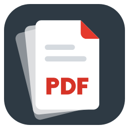
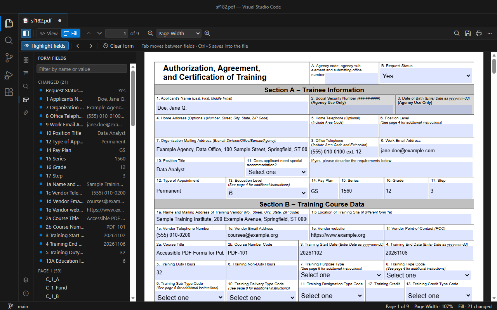
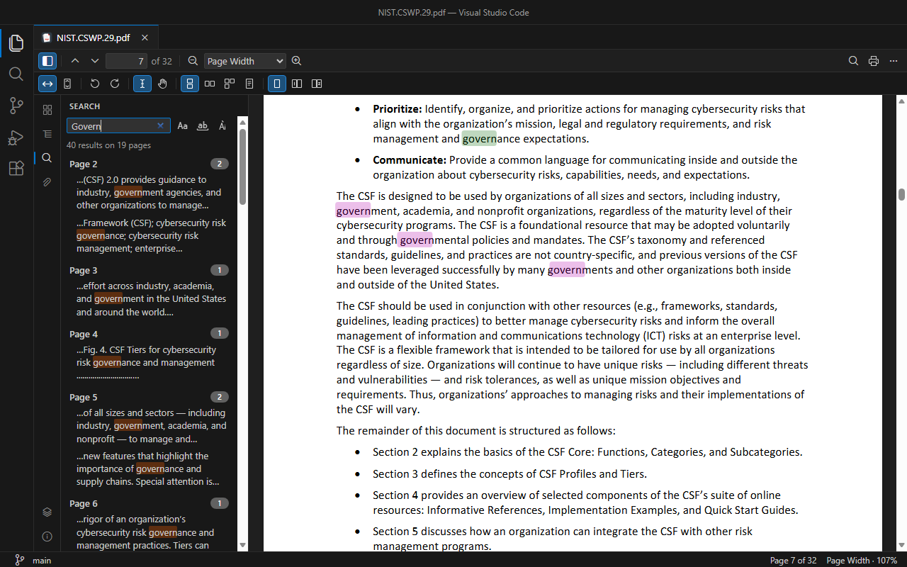
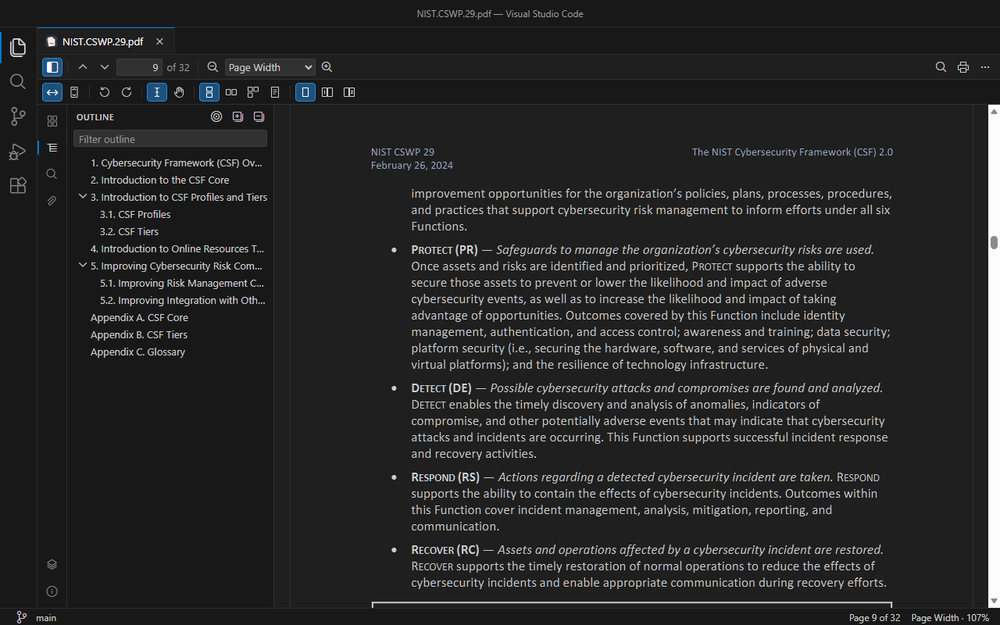
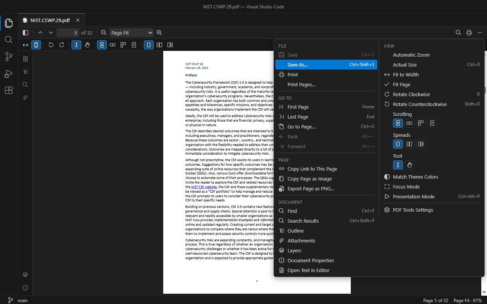

<p align="center">
  
</p>

# PDF Tools

View, fill, save, print and export PDFs in VS Code.

PDF Tools brings a full-featured PDF editor to Visual Studio Code: view, navigate, search, rotate, split, merge, print and save PDF files without leaving the editor.

One of its key features, missing from most PDF extensions for VS Code, is **real form filling**: fill in a PDF form and **save the values into the file** with <kbd>Ctrl</kbd>+<kbd>S</kbd>, exactly like a text file. Unsaved changes show the dot on the tab, auto save works, and Revert, Save As and hot exit (restoring unsaved changes after a restart) are supported.



## Features

### View

- Fast, accurate rendering with [PDF.js](https://mozilla.github.io/pdf.js/), following your VS Code **theme**.
- Page navigation: previous/next, first/last, **Go to Page** (<kbd>Ctrl</kbd>+<kbd>G</kbd>, accepts page labels like *iv* or *A-1*), **Back/Forward** after following a link (<kbd>Alt</kbd>+<kbd>←</kbd>/<kbd>→</kbd>).
- Zoom: in/out, automatic, actual size, fit page, fit width, presets, <kbd>Ctrl</kbd>+mouse wheel and trackpad pinch.
- Rotate the view, **scrolling** (vertical, horizontal, wrapped, one page at a time) and **spreads** (none, odd, even).
- Text selection tool and **hand tool** (drag to pan).
- **Remembers where you left each PDF**: page, zoom, rotation, scrolling, spreads, sidebar and mode.
- **Match Theme Colors**: pages in your theme's background and text colors — dark pages in a dark theme, with the hues of images and colored text preserved.
- **Focus mode**: the page gets the whole editor; one floating toolbar appears when you move the mouse.
- **Presentation mode** (<kbd>Ctrl</kbd>+<kbd>Alt</kbd>+<kbd>P</kbd>): one page at a time, full screen (through VS Code's Zen mode); arrow keys, <kbd>Space</kbd>, the mouse wheel or a click change page, <kbd>Esc</kbd> ends it.



### Search

- **Find** (<kbd>Ctrl</kbd>+<kbd>F</kbd>) like in VS Code: next/previous (<kbd>Enter</kbd>, <kbd>F3</kbd>), match case, whole word, highlight all, result count.
- **Accent-insensitive by default**: *onesta* also finds *onestà* (turn on *Match Diacritics* to tell them apart).
- **All results at a glance** (<kbd>Ctrl</kbd>+<kbd>Shift</kbd>+<kbd>F</kbd>): every match in the document with the surrounding text, grouped by page — click one to jump there.

### Sidebar



**Pages** (thumbnails) · **Outline** (bookmarks, with filter and *Find Current Item*) · **Search** · **Form Fields** · **Attachments** (open in VS Code or save) · **Layers** · **Document Properties** (including encryption, permissions and the **fonts**, embedded or not).

### Fill forms

- Text fields, checkboxes, radio buttons, drop-down lists and list boxes (AcroForm).
- **Fill mode** opens automatically for PDFs with form fields: highlight fields, next/previous field, **next required empty field**, **Form Fields** panel (changed, required, by page; filter by name or value), **Clear Form**.
- **Save into the file**: the **Save** button (enabled when there are unsaved changes), <kbd>Ctrl</kbd>+<kbd>S</kbd>, **Save As…**, *File: Revert File* and auto save. Changes are written as an incremental update, so the original content of the file is preserved byte for byte.
- **Export and import form data** as JSON or XFDF (the format of Acrobat and most PDF tools) — for example, to fill a new copy of a character sheet with the values of an old one.
- **Hot exit**: unsaved form values survive a VS Code restart.
- **Several editors on one file**: values typed in one appear in the other.

### Export and share

- **Open Text in Editor**: the text of every page in a new editor tab, ready to copy, search or save.
- **Copy Page as Image** (to the clipboard) and **Export Page as PNG…**, with the form values.
- **Copy Link to This Page**: a `vscode://` link that opens the PDF at that page — paste it in your notes, a Markdown file or a chat.

### More

- **Print** the filled document through your system PDF application — all pages, the current page or a range (**Print Pages…**: `1-3, 7, 10-`).
- **Password-protected PDFs**: VS Code asks for the password.
- **External changes**: the PDF reloads automatically when it changes on disk (if you have unsaved changes, PDF Tools asks first).
- Everything is in the Command Palette (**PDF Tools: …**) and in the status bar (page, zoom, form state).

## Usage



Open any `.pdf` file. To open a PDF with another editor, right-click it and choose **Open With…**.

The toolbar has two rows: the first is always the same (sidebar, **View/Fill** mode, page, zoom, find, save, print, **…** menu); the second shows the tools of the current mode. Every action is also in the **…** menu and in the Command Palette. In Focus mode (`pdfTools.toolbar: floating`) the first row floats at the bottom of the page and the mode tools are in the **…** menu.

| Shortcut | Action |
|---|---|
| <kbd>Ctrl</kbd>+<kbd>F</kbd> · <kbd>F3</kbd> · <kbd>Shift</kbd>+<kbd>F3</kbd> | Find · next · previous |
| <kbd>Ctrl</kbd>+<kbd>Shift</kbd>+<kbd>F</kbd> | All search results |
| <kbd>Ctrl</kbd>+<kbd>G</kbd> | Go to page |
| <kbd>Ctrl</kbd>+<kbd>S</kbd> · <kbd>Ctrl</kbd>+<kbd>Shift</kbd>+<kbd>S</kbd> | Save · Save As |
| <kbd>Ctrl</kbd>+<kbd>Alt</kbd>+<kbd>P</kbd> | Presentation mode |
| <kbd>Ctrl</kbd>+<kbd>=</kbd> · <kbd>Ctrl</kbd>+<kbd>-</kbd> · <kbd>Ctrl</kbd>+<kbd>0</kbd> | Zoom in · out · actual size |
| <kbd>Alt</kbd>+<kbd>←</kbd> · <kbd>Alt</kbd>+<kbd>→</kbd> | Back · forward (after following a link) |
| <kbd>N</kbd>/<kbd>P</kbd> · <kbd>Home</kbd>/<kbd>End</kbd> | Next/previous page · first/last page |
| <kbd>R</kbd> · <kbd>Shift</kbd>+<kbd>R</kbd> | Rotate clockwise · counterclockwise |
| <kbd>H</kbd> · <kbd>S</kbd> | Hand tool · text selection |
| <kbd>1</kbd> · <kbd>2</kbd> | View mode · Fill mode |
| <kbd>F4</kbd> | Toggle sidebar |

Single-key shortcuts work when the focus is not in a form field.

### Using PDF Tools together with another PDF extension

If another PDF extension (for example *vscode-pdf*) is also installed, VS Code shows *"There are multiple default editors available for the resource"* the first time you open a PDF. Choose **PDF Viewer** (from PDF Tools) and confirm it as the default, or add this to your settings:

```json
"workbench.editorAssociations": {
  "*.pdf": "pdfTools.editor"
}
```

PDF Tools also reads vscode-pdf's `pdf-preview.default.*` settings when its own are not set.

### Printing

Click the **Print** button in the PDF toolbar or in the editor title bar, or run **PDF Tools: Print** from the Command Palette. To print only some pages, use **Print Pages…** in the **…** menu: the current page, or pages and ranges like `1-3, 7, 10-`.

VS Code does not let extensions open the print dialog (webviews are sandboxed). PDF Tools therefore writes a temporary copy of the document, **including form values you have not saved yet**, and opens it in your system PDF application, where you print it. Temporary copies are deleted after a day.

## Settings

| Setting | Default | Description |
|---|---|---|
| `pdfTools.default.mode` | `auto` | Mode a PDF opens in: `auto` (Fill when it has editable form fields, otherwise View), `view` or `fill`. A mode you pick for a file is remembered. |
| `pdfTools.default.scale` | `auto` | Zoom: `auto`, `page-actual`, `page-fit`, `page-width` or a scale (`1.5` = 150%). |
| `pdfTools.default.scrollMode` | `vertical` | `vertical`, `horizontal`, `wrapped` or `page`. |
| `pdfTools.default.spreadMode` | `none` | `none`, `odd` or `even`. |
| `pdfTools.default.cursor` | `select` | `select` (text selection) or `hand`. |
| `pdfTools.default.sidebar` | `false` | Show the sidebar when a PDF opens. |
| `pdfTools.restoreViewState` | `true` | Reopen each PDF where you left it. |
| `pdfTools.toolbar` | `fixed` | `fixed`: toolbars above the page. `floating`: **Focus mode**, one auto-hiding toolbar over the page. **PDF Tools: Toggle Focus Mode** switches one editor. |
| `pdfTools.pageColors` | `off` | `off`: the document's own colors. `theme`: the color theme's background and text colors (printing and exports are not affected). **PDF Tools: Toggle Theme Colors for Pages** switches one editor. |
| `pdfTools.print.method` | `systemViewer` | `systemViewer`: open the temporary copy in the system PDF application. `windowsPrintVerb` (Windows only): send it to the default application's *Print* command instead; falls back to `systemViewer` if that fails. |

The `pdfTools.default.*` settings fall back to vscode-pdf's `pdf-preview.default.*` ones (scale, scrollMode, spreadMode, cursor, sidebar).

## Known limitations

- **XFA forms** (dynamic forms created with Adobe LiveCycle/AEM Designer) are not supported. PDF Tools shows a warning instead of the form. Documents that contain both XFA and a standard form are filled through the standard form.
- **Characters the field's font cannot encode.** Many forms use the non-embedded Helvetica font, which only covers Western European characters (Windows-1252). Values with other characters — for example `ō` or `ū` — **are saved correctly**, but PDF.js cannot draw them with that font, so it marks the document (`NeedAppearances`) and leaves drawing the field to the PDF viewer that opens the file. Viewers that honor this flag redraw the field; some simpler viewers may show it empty until it is edited.
- **Scanned PDFs** without a text layer cannot be searched or exported as text (no OCR).
- **Presentation mode** uses VS Code's Zen mode for full screen (webviews cannot use the browser's full screen). If you were already in Zen mode, ending the presentation leaves it.
- **Remote windows** (WSL, SSH, containers) have not been tested. Printing there is not expected to work: the temporary copy is written on the remote machine, while the PDF application runs on yours.
- **Editing the existing text** of a PDF is not supported.

## Languages

PDF Tools follows VS Code's display language: **English**, **Italian**, **French** and **German** (menus, toolbars, panels, messages, commands and settings).

Screenshots show two public-domain U.S. government documents: OPM Standard Form 182 (filled with fictitious data) and NIST Cybersecurity White Paper 29, *The NIST Cybersecurity Framework (CSF) 2.0*.

## Privacy

PDF Tools works offline. It sends no telemetry and makes no network requests; PDFs are processed locally inside VS Code.

## License

[MIT](LICENSE) © [Ryadel](https://www.ryadel.com). PDF Tools bundles PDF.js (Apache License 2.0) and other components under their own licenses; see [THIRD_PARTY_NOTICES.md](THIRD_PARTY_NOTICES.md).

Source code: [github.com/Ryadel/PDF-Tools](https://github.com/Ryadel/PDF-Tools). Questions, bug reports and feature requests: [ryadel.com/en/contacts](https://www.ryadel.com/en/contacts/).
